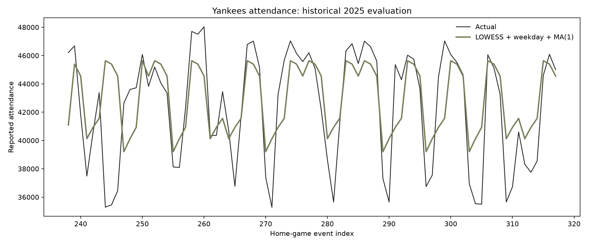

# New York Yankees Attendance Forecasting

**Ian Kimura | UCLA STATS 415 | Time series analysis and sports analytics**

How much of Yankees home attendance can be forecast from historical patterns
and the day of the week? This project separates a smooth trend and weekday
effects from attendance, then models the remaining dependence with ARMA models.
It explores a forecasting problem relevant to stadium staffing, concessions,
and demand planning; no operational deployment or financial impact was measured.



## Results

The analysis uses **317 home-game observations** from the supplied 2022-2025
exports: **237 training games from 2022-2024** and **80 evaluation games from
2025**. These counts describe the supplied, filtered data rather than complete
nominal season schedules.

| Forecast | 2025 RMSE (attendees) |
| --- | ---: |
| LOWESS trend + weekday effects + MA(1) | **3,023.78** |
| LOWESS trend + weekday effects + ARMA(2,1) | 3,084.70 |
| Training weekday average | 3,237.16 |
| Training overall average | 4,236.39 |

The MA(1) approach reduces RMSE by approximately **6.6%** against the weekday
average and **28.6%** against the overall average in this historical evaluation.
The two average baselines were added during repository preparation; they are
not results from the original course submission. ARMA(2,1) was reported at
3,084.73 in the original notebook; the local dependency versions reproduce
3,084.70, a small numerical difference. MA(1) reproduces to two decimal places.

## Approach

1. Filter schedule exports to home games and clean dates and attendance.
2. Represent observations in home-game event time, preserving their sequence.
3. Examine autocorrelation, partial autocorrelation, and periodograms.
4. Estimate a LOWESS trend on training data with smoothing fraction 0.15.
5. Estimate weekday effects from training detrended attendance.
6. Compare ten low-order AR/MA/ARMA candidates using AIC and BIC.
7. Compare MA(1) and ARMA(2,1) forecasts on 2025 observations, adding back
   weekday effects and the final training LOWESS trend value.

ARMA(2,1) had the lowest information criteria in the original analysis but
showed estimation concerns, including a near-boundary MA coefficient. MA(1)
had slightly lower evaluation RMSE and was chosen in the report.

## Run locally

Use **Python 3.12**. Open a terminal in this project folder:

```bash
python3 -m venv .venv
source .venv/bin/activate
python -m pip install -r requirements.txt
python src/forecast.py
```

On Windows, activate with `.venv\Scripts\activate` instead.

The script reads the four CSVs in `data/raw/` and writes:

- `results/metrics.json`: sample counts and RMSE values.
- `results/model_comparison.csv`: information criteria and fitting warnings.
- `results/predictions_2025.csv`: actual attendance and forecasts.
- `figures/reproduced_forecast.png`: the comparison chart above.

To explore the full original workflow in a portable notebook:

```bash
python -m pip install jupyterlab
python -m jupyterlab
```

Open `notebooks/yankees_attendance.ipynb` and choose Run All. This copy replaces
Colab uploads and `/content/` paths with project-relative paths. Its legacy
future-projection section is retained and explicitly labeled as illustrative.

The original output-bearing notebook is preserved in
[`notebooks/original_colab.ipynb`](notebooks/original_colab.ipynb).
The [original Colab link](https://colab.research.google.com/drive/11tWEQhrfFmbyuQwKFdtj3t5o0zMF8TPk)
may require the owner's permission; the repository copy is self-contained.

## Project files

```text
data/raw/                         Original season CSV exports
data/README.md                    Provenance and cleaning notes
notebooks/original_colab.ipynb     Original notebook with saved outputs
notebooks/yankees_attendance.ipynb Portable exploratory workflow
src/forecast.py                   Reproducible historical evaluation
src/original_colab_export.py      Original Colab Python export
reports/                         Original report and presentation PDFs
results/                         Reproduced metrics and predictions
figures/                         Original figures and reproduced chart
docs/                            Publishing steps and portfolio summary
```

Read the [full report](reports/STATS_415_Final_Report.pdf) or
[presentation](reports/Yankees%20Attendance%20Forecasting.pdf).
The original Python export requires Colab; use the portable notebook or
`src/forecast.py` for local execution.

## Limitations and next steps

- **Evaluation informed model choice.** Parameters were fitted on 2022-2024,
  but 2025 RMSE helped choose between MA(1) and ARMA(2,1). Treat the reported
  scores as historical comparison results, not an untouched final test of the
  selected model. A next iteration should use rolling validation within
  training seasons and a separate final test period.
- **Event time is not calendar time.** Seven home games do not necessarily
  represent seven calendar days. A spectral peak near seven observations is
  not by itself evidence of a weekly calendar cycle; weekday effects are
  estimated using the actual dates.
- **Missing drivers.** Weather, opponent, holidays, promotions, and team
  performance are omitted. These are potential predictors, not demonstrated
  improvements in this study.
- **Forecast assumptions.** The training trend is held flat. The original
  20-game future section repeats the last seven observed weekdays without
  refitting through 2025 or advancing the residual forecast origin correctly.
  It is an illustrative legacy scenario, not a valid current forecast. The
  reproduction script intentionally evaluates historical 2025 predictions only.
- **Coverage and uncertainty.** Audit missing home-game attendance, evaluate
  prediction intervals, and test robustness across seasons before operational use.

## Source and attribution

The report attributes attendance exports to Baseball Reference. See
[`data/README.md`](data/README.md) for provenance. The original analysis and
reports are Ian Kimura's course project. Repository preparation adds portable
execution, baseline comparisons, documentation, and reproducibility checks;
the original artifacts are preserved separately. No license is assigned to
third-party data or to the project by this preparation step.
